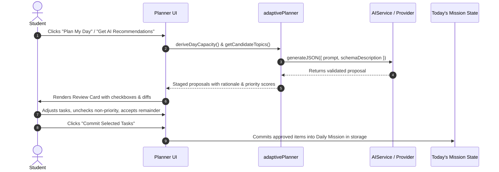

# NEXORA — AI System Specification & Advisory Architecture

## 1. AI Philosophy & Guiding Principles

NEXORA treats Artificial Intelligence not as an autonomous agent that takes over the student's calendar, but as a **specialized academic advisor, cognitive coach, and retrospective analyst**.

### Core Tenets:
1. **Advisory, Never Authoritarian**: AI never writes directly to persistent storage. All AI outputs are returned as structured recommendations staged in interactive **diff review cards** or approval modals.
2. **Context-Grounded**: The AI is fed real mathematical constraints (uncommitted minutes, class schedules, prerequisite readiness, recent energy and comprehension ratings). It cannot schedule impossible hours.
3. **Socratic Over Superficial**: The AI Tutor encourages active recall, conceptual models, and cognitive retention, refusing to simply provide homework answers or superficial summaries.
4. **Resilient Local Fallback**: If the internet disconnects or no API key is present, the system defaults to deterministic rule-based algorithms without breaking the user experience.
5. **Strict Validation Boundary**: All structured outputs from external LLMs pass through schema validation and defensive sanitization before reaching the UI.

---

## 2. AI Subsystem Architecture

```mermaid
graph TB
    subgraph ClientUI["Client UI Layer"]
        UIPlanner[Planner Module]
        UITutor[Socratic Tutor Chat]
        UIWeekly[Weekly Review Module]
        UISemester[Semester Achievement Modal]
        UIRoadmap[Curriculum Roadmap]
        AIDiffCard[Interactive Diff & Review Cards]
    end

    subgraph DomainServices["Domain AI Services"]
        TutorSvc[tutorService.ts]
        WeeklySvc[weeklyReviewService.ts]
        SemesterSvc[semesterReviewService.ts]
        AdaptivePlanner[adaptivePlanner.ts]
    end

    subgraph CoreAI["Core Client AI Layer (src/services/ai/)"]
        AIServiceGateway[AIService (service.ts)]
        Registry[ProviderRegistry (registry.ts)]
        ValidationBoundary[Validation & Sanitization (validation.ts)]
        GeminiAdapter[GeminiProvider]
        CustomAdapter[CustomProxyProvider]
        OfflineAdapter[OfflineProvider]
    end

    subgraph ServerGateway["Server Proxy Gateway (server.ts)"]
        ProxyHealth["POST /api/ai/proxy/health"]
        ProxyText["POST /api/ai/proxy/generate-text"]
        ProxyJSON["POST /api/ai/proxy/generate-json"]
        ProxyCustom["/api/ai/proxy/custom/*"]
        GenAIClient["GoogleGenAI Client (@google/genai)"]
    end

    subgraph Upstream["Upstream Foundation Models"]
        GeminiFlash["Google Gemini 3.8 Flash"]
    end

    UIPlanner --> AdaptivePlanner
    UITutor --> TutorSvc
    UIWeekly --> WeeklySvc
    UISemester --> SemesterSvc
    UIRoadmap --> AIServiceGateway

    DomainServices --> AIServiceGateway
    AIServiceGateway --> Registry
    Registry --> GeminiAdapter
    Registry --> CustomAdapter
    Registry --> OfflineAdapter

    GeminiAdapter --> ProxyJSON
    GeminiAdapter --> ProxyText
    CustomAdapter --> ProxyCustom

    ProxyJSON --> GenAIClient
    ProxyText --> GenAIClient
    GenAIClient --> GeminiFlash

    GeminiAdapter --> ValidationBoundary
    OfflineAdapter --> ValidationBoundary
    ValidationBoundary --> DomainServices
    DomainServices --> AIDiffCard
    AIDiffCard -->|Student Approval| UIPlanner
```

---

## 3. Specialized AI Domain Services

### 3.1 Adaptive Daily Mission Proposal Engine (`adaptivePlanner.ts`)
Generates recommended study plans within strictly bounded time capacity.

- **Inputs Supplied to Model**:
  - Target Date and Day of Week
  - Net Available Study Time (calculated deterministically by `plannerEngine.ts`)
  - Fixed commitments for the day (classes, labs, commutes)
  - Enrolled subjects and weekly pacing deficits
  - Candidate Topics where prerequisite conditions are met (`prerequisitesMet: true`)
  - Recent study feedback (comprehension ratings 1–5★ and energy ratings 1–5)
- **Enforced Constraints**:
  - Total planned study minutes **MUST NOT** exceed 85% of net available minutes.
  - Tasks must have concrete actionable deliverables.
  - Subjects with weekly pacing deficits receive higher priority.
  - Validated with `validateAIProposalResponse()` to guarantee valid item schemas.

#### Interactive Diff Review Flow:


---

### 3.2 Context-Aware Socratic AI Academic Tutor (`tutorService.ts`)
Provides interactive, context-aware conceptual coaching grounded in active coursework.

- **Modes Supported**:
  1. **Explain (`mode: 'explain'`)**: Intuition-first 5-step breakdown (Intuition, Core Mechanism, Visual Analogy, Concrete Code/Math Example, Comprehension Check).
  2. **Why (`mode: 'why'`)**: Answers "why do we need this?" highlighting historical problems and real systems failure cases.
  3. **Example (`mode: 'example'`)**: Realistic end-to-end practical scenario.
  4. **Analogy (`mode: 'analogy'`)**: Real-world physical analogy mapping concepts 1:1.
  5. **Practice (`mode: 'practice'`)**: Generates 1 to 3 progressive challenge problems with hints.
  6. **Test (`mode: 'test'`)**: Multi-format evaluation (MCQ, short answer, code, explain-back).
  7. **Explain-Back (`mode: 'explain_back'`)**: Diagnostic evaluation of student's own explanation with 0–100 score, what was right, missing gaps, and probing follow-up.
  8. **Review Answer (`mode: 'review_answer'`)**: Detailed solution breakdown without giving away answers prematurely.
- **Context Injection**: Automatically injects active semester, subject catalog code, topic name, and current mastery level. Warns with locked-prerequisite banner if student attempts locked topics.
- **Advisory Boundary**: The tutor is strictly prohibited from mutating roadmaps or marking topics completed on its own.

---

### 3.3 Longitudinal Weekly Review Engine (`weeklyReviewService.ts`)
Synthesizes weekly study execution into quantitative metrics and strategic next-week proposals.

- **Calculated Deterministic Metrics**:
  - Execution percentage ($\text{actualMinutes} / \text{plannedMinutes}$)
  - Consistency score (0–100) based on sessions completed, execution ratio, subject diversity, streak continuity, and reflection depth.
  - Subject study hours vs credit targets.
  - Mastery progression across studied topics.
- **AI Advisory Output**:
  - Interpretation of weekly performance.
  - Behavioral learning observations and potential bottlenecks.
  - Data-backed next-week proposed items with target sessions and explicit rationale.
- **Human-in-the-Loop Commitment**: Proposals start with `accepted` status and can be modified, skipped, or committed to future daily missions by the student.

---

### 3.4 Semester Milestone Retrospective & Holiday Focus (`semesterReviewService.ts`)
Evaluates completed academic semesters and plans rejuvenating, high-impact holiday roadmaps.

- **Semester Achievement Report**:
  - Aggregates all completed sessions, comprehension ratings, goal completions, and career skill advancements.
  - Generates qualitative highlights: strongest areas, attention deficits, and key learning patterns.
  - Advisory AI review synthesizes important trends and future focus areas.
- **Holiday Mode (`holidayPlanner.ts`)**:
  - Takes student holiday preferences (selected priorities e.g. DSA, Web Dev, Projects; daily capacity cap; weekly hours; protected rest days).
  - Generates multi-week holiday focus blocks that never encroach on protected rest days.

---

### 3.5 AI Curriculum & Syllabus Generator (`learningEngine.ts`)
Transforms unstructured course descriptions into Directed Acyclic Graph (DAG) topics.

- Produces 5 to 7 modular learning topics with realistic session estimates (30–90m).
- Computes valid DAG dependency edges (`prerequisiteTopicIds`) with circular dependency detection.

---

## 4. Provider Architecture & Validation Boundary

### 4.1 Provider Registry & Adapters
The `ProviderRegistry` (`src/services/ai/registry.ts`) manages active provider implementations:
- **`GeminiProvider`**: Communicates with the local Express proxy (`/api/ai/proxy/generate-json`, `/api/ai/proxy/generate-text`) using `@google/genai`.
- **`CustomProxyProvider`**: Supports custom user inference endpoints (e.g., local Ollama, vLLM, or LM Studio).
- **`OfflineProvider`**: Zero-network deterministic heuristic provider that guarantees complete offline functionality using rule-based algorithmic fallbacks.

### 4.2 Validation & Defensive Sanitization
External AI responses are inherently probabilistic and untrusted. NEXORA enforces a strict validation boundary in `src/services/validation.ts`:
- **`validateAIProposalResponse()`**: Verifies array types, minutes bounds, and default values.
- **`validateWeeklyReviewResponse()`**: Sanitizes observation lists, narrative interpretations, and proposed next-week items.
- **`validateSemesterReviewResponse()`**: Guarantees non-empty trends, strengths, weaknesses, and recommended project directions.
- If JSON parsing or schema validation encounters anomalies, the sanitization boundary injects deterministic fallbacks without failing the request or crashing the UI.

---

## 5. Security & Prompt Integrity

1. **Server Proxy Isolation**: Client-side code never communicates directly with external AI endpoints; all requests route through `server.ts`.
2. **Key Safety**: API keys are passed in the request body only when configured by the student; no keys are stored in client bundles or logged to disk.
3. **Structured Outputs**: High-reliability JSON output enforcement via `responseMimeType: "application/json"`.
4. **Advisory-Only Architecture**: AI systems possess zero mutation capabilities over the local database; only explicit student actions dispatch changes to `dataService`.
