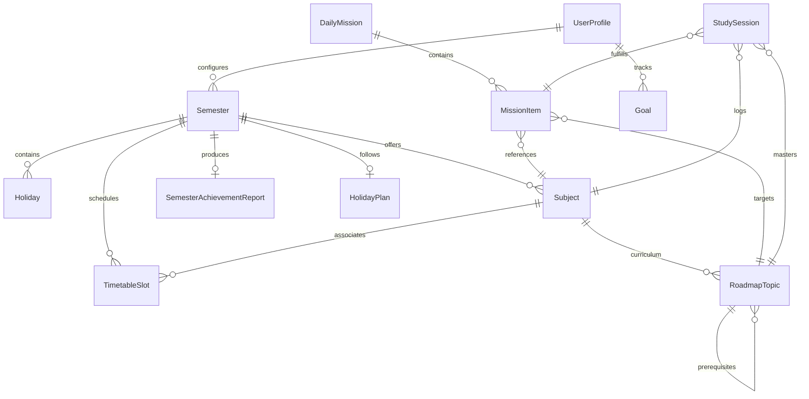
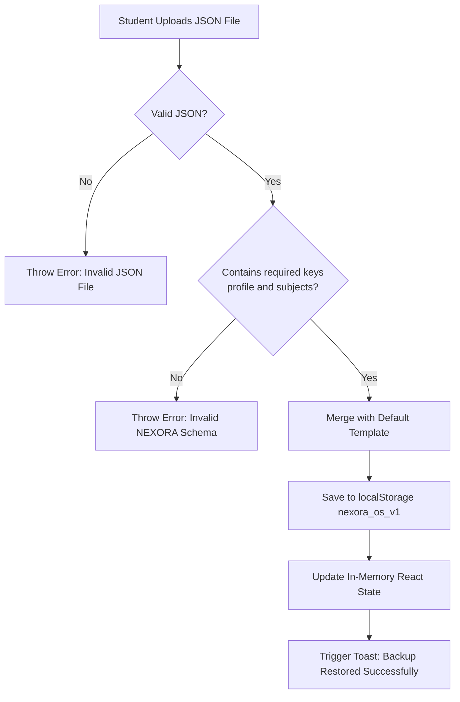

# NEXORA — Data Architecture & Storage Specification

## 1. Storage Architecture Overview

NEXORA employs an **offline-first document store** modeled around browser `localStorage`. This guarantees:
- Zero cloud latency for CRUD operations.
- Immediate operational availability without internet connectivity.
- Absolute data ownership by the student.

The entire system state is encapsulated in a single, strongly-typed JSON root document stored under the storage key:
```typescript
const STORAGE_KEY = 'nexora_os_v1';
```

---

## 2. Entity-Relationship Diagram (ERD)



---

## 3. Data Entities & Schema Definitions

### 3.1 UserProfile (`profile`)
Stores student configuration, capacity thresholds, and AI provider settings.

| Field | Type | Description | Default / Example |
| :--- | :--- | :--- | :--- |
| `name` | `string` | Student's display name | `"Alex Mercer"` |
| `university` | `string` | Academic institution | `"State Polytechnic University"` |
| `degreeMajor` | `string` | Degree program & specialization | `"Computer Science & Software Engineering"` |
| `currentYear` | `string` | Academic standing | `"Year 3 (Junior)"` |
| `dailyCapacityMaxHours` | `number` | Hard daily study cap ceiling (hours) | `4.5` |
| `defaultBufferMinutes` | `number` | Transition buffer between fixed blocks (minutes) | `15` |
| `sleepHours` | `number` | Protected daily sleep budget (hours) | `8` |
| `wakeTime` | `string?` | Student wake-up time in 24h format | `"07:00"` |
| `sleepTime` | `string?` | Student sleep bedtime in 24h format | `"23:00"` |
| `travelTimeMinutes` | `number?` | Total daily transit duration | `60` |
| `aiProvider` | `'gemini' \| 'custom' \| 'offline'` | Active AI engine mode | `'gemini'` |
| `apiKey` | `string?` | Optional student-provided Gemini API key | `undefined` |
| `customEndpoint` | `string?` | Optional custom inference proxy endpoint | `undefined` |
| `aiModel` | `string?` | Preferred Gemini model variant | `'gemini-3.8-flash'` |
| `hasCompletedOnboarding` | `boolean` | Flag for first-run onboarding status | `true` |

---

### 3.2 Semester, Status & Holidays (`semesters`, `holidays`)
Defines the boundary of an academic term, state lifecycle, and non-instructional break periods.

```typescript
export type SemesterStatus = 'upcoming' | 'active' | 'completed' | 'break';

export interface Holiday {
  id: string;             // Unique ID e.g. "h-1"
  name: string;           // Display title e.g. "Reading Week"
  startDate: string;      // YYYY-MM-DD
  endDate: string;        // YYYY-MM-DD
  type: 'holiday' | 'break' | 'exam_prep';
}

export interface Semester {
  id: string;             // e.g. "sem-fall-2026"
  name: string;           // "Fall 2026 (Semester 5)"
  startDate: string;      // YYYY-MM-DD
  endDate: string;        // YYYY-MM-DD (matches actualEndDate || expectedEndDate)
  expectedEndDate?: string; // YYYY-MM-DD (target prediction)
  actualEndDate?: string;   // YYYY-MM-DD (authoritative once term concluded)
  status?: SemesterStatus;  // 'upcoming' | 'active' | 'completed' | 'break'
  examPeriod?: { startDate: string; endDate: string };
  revisionPeriod?: { startDate: string; endDate: string };
  holidayStartDate?: string;
  holidayEndDate?: string;
  nextSemesterStartDate?: string;
  holidays: Holiday[];    // Array of break periods
  targetWeeklyStudyHours: number; // e.g. 18 hours
  isActive: boolean;      // Active term indicator
}
```

---

### 3.3 Academic Subject (`subjects`)
Represents an enrolled course with weekly study pacing targets.

```typescript
export interface Subject {
  id: string;             // Unique identifier e.g. "sub-os"
  semesterId: string;     // Parent semester reference
  code: string;           // Course catalog code e.g. "CS 301"
  name: string;           // Full course name e.g. "Operating Systems"
  color: string;          // Hex color or Tailwind token e.g. "#3B82F6"
  targetWeeklyHours: number; // Weekly study goal in hours (e.g. 6)
  credits: number;        // Course credit weight (e.g. 4)
  syllabusOverview?: string; // High-level course context for AI tools
}
```

---

### 3.4 Timetable Slot & TimeBlock (`timetable`)
Represents recurring weekly commitments (Monday–Sunday) and instantiated calendar date blocks.

```typescript
export type DayOfWeek = 'monday' | 'tuesday' | 'wednesday' | 'thursday' | 'friday' | 'saturday' | 'sunday';
export type SlotType = 'lecture' | 'lab' | 'tutorial' | 'commute' | 'personal' | 'study_window' | 'break';

export interface TimetableSlot {
  id: string;             // e.g. "tt-1"
  semesterId: string;     // Enclosing semester
  subjectId?: string;     // Optional link to course (e.g. "sub-os")
  title: string;          // e.g. "CS 301: OS Lecture"
  dayOfWeek: DayOfWeek;   // Weekly recurrence
  startTime: string;      // 24-hour "HH:mm" (e.g. "09:00")
  endTime: string;        // 24-hour "HH:mm" (e.g. "10:30")
  location?: string;      // Physical room or link (e.g. "Hall 104")
  isFixed: boolean;       // true = non-negotiable commit; false = study window
  type: SlotType;         // Slot taxonomy
}

// Instantiated concrete time block for a specific calendar date
export interface TimeBlock {
  id: string;
  date: string;           // YYYY-MM-DD
  slotId?: string;        // Origin recurring slot reference
  subjectId?: string;
  title: string;
  startTime: string;      // HH:mm
  endTime: string;        // HH:mm
  durationMinutes: number;
  type: SlotType;
  isFixed: boolean;
}
```

---

### 3.5 Curriculum Roadmap Topic (`topics`)
Node in the prerequisite Directed Acyclic Graph (DAG) with multi-domain taxonomy.

```typescript
export type TopicStatus = 'locked' | 'ready' | 'in_progress' | 'completed';
export type LearningCategory = 'academic' | 'career' | 'project';

export interface RoadmapTopic {
  id: string;                  // e.g. "top-os-1"
  subjectId: string;           // Parent subject
  title: string;               // e.g. "Process Synchronization"
  description: string;         // Conceptual scope
  estimatedMinutes: number;    // Recommended single-session duration
  prerequisiteTopicIds: string[]; // Parent DAG node IDs
  status: TopicStatus;         // Computed or assigned state
  masteryLevel: number;        // 0 to 100 percentage
  notes?: string;              // Student summary notes
  orderIndex: number;          // Visual sequence ordering
  lastStudiedAt?: string;      // ISO timestamp of last logged session
  domain?: string;             // e.g. "Operating Systems", "Java", "DSA"
  category?: LearningCategory; // 'academic' | 'career' | 'project'
  stage?: string;              // e.g. "Foundations", "Core Architecture"
  stageIndex?: number;
  isUserOverride?: boolean;    // True if student explicitly bypassed prerequisites
  overrideWarning?: string;
}
```

---

### 3.6 Daily Mission & Items (`missions`)
Daily execution checklist keyed by date string (`YYYY-MM-DD`).

```typescript
export type MissionItemStatus = 'pending' | 'in_progress' | 'completed' | 'skipped' | 'missed' | 'rescheduled';
export type ActivityType = 'college_work' | 'academic_study' | 'career_learning' | 'dsa_practice' | 'project_work' | 'revision' | 'break';
export type ActivityPriority = 'high' | 'medium' | 'low';
export type ActivitySource = 'ai' | 'manual' | 'system';

export interface MissionItem {
  id: string;                  // e.g. "mi-101"
  topicId?: string;            // Link to curriculum topic
  subjectId?: string;          // Link to enrolled subject
  title: string;               // Concrete action item
  plannedMinutes: number;      // Budgeted study minutes
  actualMinutes: number;       // Elapsed study minutes
  status: MissionItemStatus;   // Task lifecycle state
  scheduledTime?: string;      // Optional planned start (e.g. "14:00")
  endTime?: string;            // Optional planned end (e.g. "14:45")
  isAIRecorded: boolean;       // True if proposed by advisory engine
  priorityScore?: number;      // AI priority ranking (0 - 100)
  reason?: string;             // Advisory rationale
  activityType?: ActivityType;
  priority?: ActivityPriority;
  source?: ActivitySource;
  domain?: 'academic' | 'career' | 'project';
  objective?: string;
  isBreak?: boolean;
  isUserOverride?: boolean;
  overrideWarning?: string;
  originalScheduledTime?: string;
  rescheduledTo?: string;
}

export interface DailyMission {
  id: string;                  // e.g. "mission-2026-09-21"
  date: string;                // "YYYY-MM-DD"
  availableMinutes: number;    // Net calculated capacity
  allocatedMinutes: number;    // Sum of planned item minutes
  items: MissionItem[];        // Ordered daily tasks
  reflectionNotes?: string;    // End-of-day journal reflection
  aiProposalRationale?: string;// Rationale from advisory AI
  checkIn?: DailyCheckInInput;
}
```

---

### 3.7 Study Session (`sessions`)
Historical log record of focused study work, comprehension ratings, and cognitive reflection.

```typescript
export interface StudySession {
  id: string;                  // e.g. "sess-1726912345678"
  missionItemId?: string;      // Optional mission item origin
  topicId?: string;            // Curriculum topic studied
  subjectId: string;           // Enclosing subject
  startTime: string;           // ISO timestamp
  endTime?: string;            // ISO timestamp
  plannedDurationMinutes: number; // Planned duration
  actualDurationMinutes: number;  // Actual duration
  comprehensionRating: 1 | 2 | 3 | 4 | 5; // 1 = Lost, 5 = Mastered
  energyRating: 1 | 2 | 3 | 4 | 5;        // 1 = Exhausted, 5 = Peak Flow
  keyTakeaways: string;        // Qualitative takeaway
  date: string;                // YYYY-MM-DD
  difficultyNote?: string;     // Roadblocks or tricky sub-concepts
}
```

---

### 3.8 Academic & Career Goals (`goals`)
Longitudinal milestone tracking across semesters and career horizons.

```typescript
export type GoalHorizon = 'semester' | 'monthly' | 'weekly' | 'career';
export type GoalStatus = 'active' | 'completed' | 'abandoned';

export interface Goal {
  id: string;                  // e.g. "goal-1"
  semesterId?: string;         // Enclosing semester scope
  subjectId?: string;          // Optional target subject
  title: string;               // e.g. "Solve 50 LeetCode Mediums"
  description?: string;
  targetValue: number;         // e.g. 50
  currentValue: number;        // e.g. 25
  unit: string;                // "%", "hours", "topics", "problems"
  horizon: GoalHorizon;        // Timeframe
  deadline?: string;           // YYYY-MM-DD
  status: GoalStatus;          // 'active' | 'completed' | 'abandoned'
  createdAt: string;           // ISO date string
}
```

---

### 3.9 Semester Achievement Report (`semesterReviews`)
Comprehensive retrospective record generated at semester completion.

```typescript
export interface SubjectSemesterProgress {
  subjectId: string;
  code: string;
  name: string;
  credits: number;
  color: string;
  actualStudyMinutes: number;
  targetWeeklyHours: number;
  progressPercentage: number;
  averageComprehension: number;
  totalTopics: number;
  completedTopics: number;
  inProgressTopics: number;
}

export interface CareerSkillProgress {
  skill: string;
  startingLevel: string;
  currentLevel: string;
  masteryPercentage: number;
  evidence: string;
}

export interface SemesterAchievementReport {
  semesterId: string;
  semesterName: string;
  startDate: string;
  endDate: string;             // Authoritative actualEndDate
  durationDays: number;
  totalPlannedStudyMinutes: number;
  totalActualStudyMinutes: number;
  executionPercentage: number;
  completedSessionsCount: number;
  skippedSessionsCount: number;
  missedSessionsCount: number;
  rescheduledSessionsCount: number;
  averageComprehension: number;
  averageEnergy: number;
  consistencyScore: number;
  subjectsStudiedCount: number;
  subjectBreakdowns: SubjectSemesterProgress[];
  topicsCompletedCount: number;
  topicsInProgressCount: number;
  topicsLockedCount: number;
  masteryChanges: Array<{
    topicId: string;
    title: string;
    subjectCode: string;
    beforeMastery: number;
    currentMastery: number;
    delta: number;
  }>;
  goalsCompletedCount: number;
  goalsIncompleteCount: number;
  goalsPartiallyCompletedCount: number;
  goals: Array<{
    id: string;
    title: string;
    targetValue: number;
    currentValue: number;
    unit: string;
    status: GoalStatus;
    progressPercentage: number;
  }>;
  academicMinutes: number;
  careerMinutes: number;
  projectMinutes: number;
  revisionMinutes: number;
  projectsCompletedCount: number;
  careerSkills: CareerSkillProgress[];
  strongestAreas: Array<{ name: string; reason: string }>;
  needsAttention: Array<{ name: string; reason: string }>;
  keyLearningPatterns: Array<{ title: string; description: string; evidence: string }>;
  completedAt: string;
}
```

---

### 3.10 Holiday Planning & Mode (`holidayPlans`)
Structured multi-week vacation roadmap protecting rest days and scheduling career focus blocks.

```typescript
export type HolidayPriority =
  | 'dsa'
  | 'aiml'
  | 'web_dev'
  | 'backend_dev'
  | 'projects'
  | 'git_github'
  | 'internship_prep'
  | 'communication'
  | 'career_exploration'
  | 'revision'
  | 'rest';

export interface HolidayPlanPreferences {
  selectedPriorities: HolidayPriority[];
  weeklyAvailableHours: number;
  preferredStudyTime: 'morning' | 'afternoon' | 'evening' | 'flexible';
  daysOff: DayOfWeek[];
  maxDailyCapacityHours: number;
  startDate: string;
  endDate: string;
  nextSemesterStartDate?: string;
  customNotes?: string;
}

export interface HolidayWeekFocus {
  weekNumber: number;
  title: string;
  focusAreas: string[];
  plannedHours: number;
  restDays: DayOfWeek[];
  suggestedTasks: Array<{
    id: string;
    title: string;
    priority: HolidayPriority;
    estimatedMinutes: number;
    reason: string;
  }>;
}

export interface HolidayPlan {
  id: string;
  semesterId: string;
  preferences: HolidayPlanPreferences;
  availableDays: number;
  weeks: HolidayWeekFocus[];
  holidayGoals: Goal[];
  createdAt: string;
}
```

---

## 4. Storage Lifecycle & Backup Specification

### 4.1 Export Format (`exportStateAsJSON`)
- Downloads a formatted `.json` file containing the complete `AppState` entity model:
```json
{
  "profile": { ... },
  "activeSemesterId": "sem-fall-2026",
  "semesters": [ ... ],
  "subjects": [ ... ],
  "timetable": [ ... ],
  "topics": [ ... ],
  "missions": { ... },
  "sessions": [ ... ],
  "goals": [ ... ],
  "semesterReviews": { ... },
  "holidayPlans": { ... }
}
```
- Filename pattern: `nexora_backup_YYYY-MM-DD.json`.

### 4.2 Import & Validation Routine (`importStateFromJSON`)


### 4.3 Storage Capacity Analysis
- Typical browser `localStorage` quota: **5.0 MB – 10.0 MB**.
- Average NEXORA record sizes:
  - 1 Semester + 5 Subjects + 40 Timetable slots: **~6 KB**
  - 40 Topics with notes: **~18 KB**
  - 180 Days of Daily Missions: **~45 KB**
  - 500 Completed Study Sessions with reflections: **~120 KB**
- Total estimated footprint for an entire academic year: **~190 KB (< 4% of quota)**.
