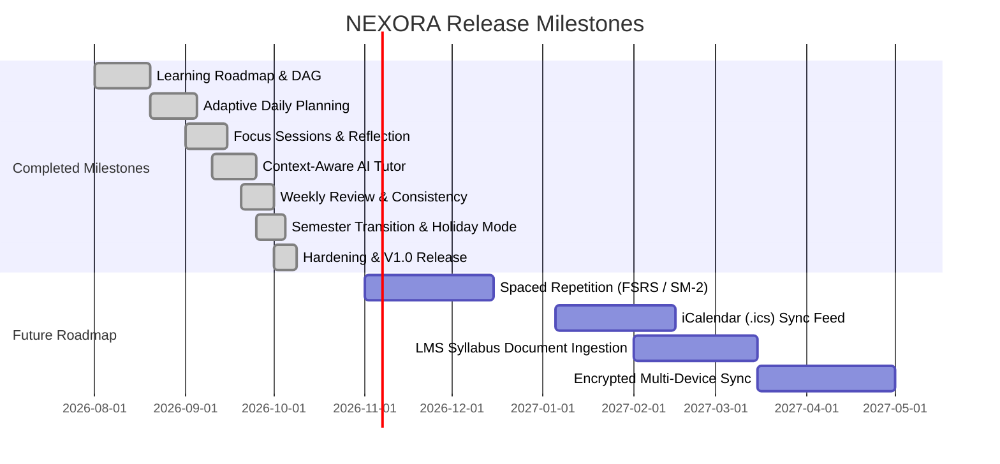

# NEXORA — Product Roadmap & Milestones

## 1. Roadmap Timeline Overview

---

## 2. Completed Milestones (v1.0.0 Production Release)

### Milestone 1: Learning Roadmap
*Status: Complete & Operational*
- [x] **Directed Acyclic Graph (DAG) Engine**: Topic dependencies modeled as explicit prerequisite graphs with cycle detection.
- [x] **Multi-Domain Taxonomy**: Support for academic subjects, career skills (DSA, Systems, Web, AI), and project tracks.
- [x] **Pedagogical Stages**: Topics grouped into structured stages (Foundations, Core Mechanisms, Applied Systems, Advanced Synthesis).
- [x] **Dynamic Status Lifecycle**: Deterministic state evaluation (`locked`, `ready`, `in_progress`, `completed`).
- [x] **Mastery Progression Mechanics**: Evidence-backed mastery boosts tied to study sessions, practice, and comprehension ratings.
- [x] **Student Override Boundary**: Option to override prerequisite locks with clear visual advisory warning indicators.

---

### Milestone 2: Adaptive Daily Planning
*Status: Complete & Operational*
- [x] **Deterministic Capacity Engine**: Mathematical derivation of study capacity from 1,440 minutes minus sleep, fixed timetable commitments, and transition buffers.
- [x] **Daily Check-In Workflow**: Captures energy level, transit delays, late arrivals, and urgent assignments to dynamically resize daily study capacity.
- [x] **Protected Sleep Schedule**: Robust calendar-day interval calculations supporting standard and overnight sleep hours without encroachment.
- [x] **Intelligent Candidate Selection**: Filters topics based on prerequisite readiness, subject pacing deficits, and active goals.
- [x] **Human-in-the-Loop Diff Staging**: Staged AI mission proposals with explicit rationale and priority scores for interactive student approval.

---

### Milestone 3: Focus Sessions
*Status: Complete & Operational*
- [x] **Timed Study Blocks**: Customizable Pomodoro timers (25m, 45m, 60m, custom) with active progress visualization.
- [x] **Planned vs. Actual Tracking**: Precise logging of scheduled duration versus actual focused study time.
- [x] **Cognitive Reflection**: Post-session capture of comprehension ratings (1–5★), energy flow (1–5), roadblocks, and key takeaways.
- [x] **Evidence Logging**: Session records automatically update topic study evidence (`studied`, `practiced`, `assessed`, `mastered`).

---

### Milestone 4: Context-Aware AI Tutor
*Status: Complete & Operational*
- [x] **8 Pedagogical Coaching Modes**: Socratic Probing, Why (motivation & failure cases), Example, Analogy, Practice, Test, Explain-Back, and Answer Review.
- [x] **Context Grounding**: Deep awareness of current semester, course code, active topic, and student mastery level.
- [x] **Explain-Back Diagnostics**: Automated rubric scoring (0–100), identifying correct concepts, missing gaps, and targeted probing questions.
- [x] **Practice & Test Generation**: Multi-format question generation with progressive hints and comprehensive scoring.
- [x] **Advisory Safety Boundary**: Tutor strictly acts as coach; cannot mutate roadmaps or mark topics completed unilaterally.

---

### Milestone 5: Weekly Review
*Status: Complete & Operational*
- [x] **Longitudinal Quantitative Analytics**: Automated Monday–Sunday boundary aggregation of planned vs. actual minutes and execution percentage.
- [x] **Consistency Score Engine**: Transparent 0–100 score derived from 5 weighted factors (sessions completed, execution ratio, subject diversity, streak continuity, reflection depth).
- [x] **Subject Pacing Matrix**: Weekly logged hours benchmarked against target credit hours to surface academic deficits early.
- [x] **Mastery Delta Tracking**: Granular tracking of topic comprehension improvements across the week.
- [x] **Strategic Next-Week Proposals**: Actionable focus recommendations with data-backed rationale that students can accept, modify, or commit directly to daily missions.

---

### Milestone 6: Semester Transition & Holiday Mode
*Status: Complete & Operational*
- [x] **Semester State Machine**: Automatic derivation of semester lifecycle states (`upcoming`, `active`, `completed`, `break`).
- [x] **Semester Achievement Report**: Comprehensive retrospective capturing total hours, subject breakdowns, mastery shifts, goal completions, and qualitative trends.
- [x] **Safe Term Archival**: Concluding a semester marks it completed and preserves all historical sessions, subjects, and reviews indefinitely.
- [x] **Holiday Preferences & Capacity**: Configurable vacation goals, weekly hours, daily caps, and protected rest days.
- [x] **Multi-Week Holiday Roadmap**: Structured weekly focus themes (DSA, Web Dev, Backend, Projects, Rest) that strictly avoid scheduling on protected days off.

---

### Milestone 7: Hardening & V1.0 Release
*Status: Complete & Operational*
- [x] **Canonical Local Date Engine**: Deterministic `getTodayDateString()` returning local calendar dates without UTC day shifts.
- [x] **Historical Term Protection**: Onboarding wizard updates active terms in-place and preserves all historical semesters and reports.
- [x] **Overnight Sleep Arithmetic**: Accurate non-convex interval math in `plannerEngine.ts` preventing task overlap across midnight sleep schedules.
- [x] **Multi-Provider AI Architecture**: Clean separation between `AIService`, `ProviderRegistry`, `GeminiProvider`, and zero-network `OfflineProvider`.
- [x] **Schema Validation & Sanitization**: Defensive boundaries in `validation.ts` ensuring robust error recovery and zero application crashes.
- [x] **Comprehensive Test Verification**: 300+ deterministic unit and integration test assertions across all core engines passing cleanly.

---

## 3. Future Milestones

### Milestone 8: v1.1.0 — Spaced Repetition & Retention (Planned)
*Target: Q4 2026 – Q1 2027*
- [ ] **FSRS / SM-2 Algorithmic Scheduling**: Mathematical modeling of memory retrievability and stability over time.
- [ ] **Topic Memory Decay Visualizer**: Color-coded topic mastery degradation indicating concepts due for review.
- [ ] **Automated Active Recall Card Generator**: One-click generation of conceptual flashcards from Socratic tutoring conversations.

### Milestone 9: v1.2.0 — Academic Ecosystem & Calendar Feeds (Planned)
*Target: Q1 2027*
- [ ] **RFC 5545 iCalendar Subscription**: Live `.ics` export feed for Google Calendar, Apple Calendar, and Outlook.
- [ ] **Canvas LMS & Blackboard Syllabus Ingestion**: Upload course syllabus files (PDF/Markdown) to automatically extract reading lists and exam deadlines.
- [ ] **Multi-Term Historical Search**: Search and review notes across past semesters.

### Milestone 10: v2.0.0 — Encrypted Multi-Device Sync (Future)
*Target: 2027*
- [ ] **Zero-Knowledge Encrypted Synchronization**: End-to-end encrypted backup syncing across laptops, tablets, and phones without central database lock-in.
